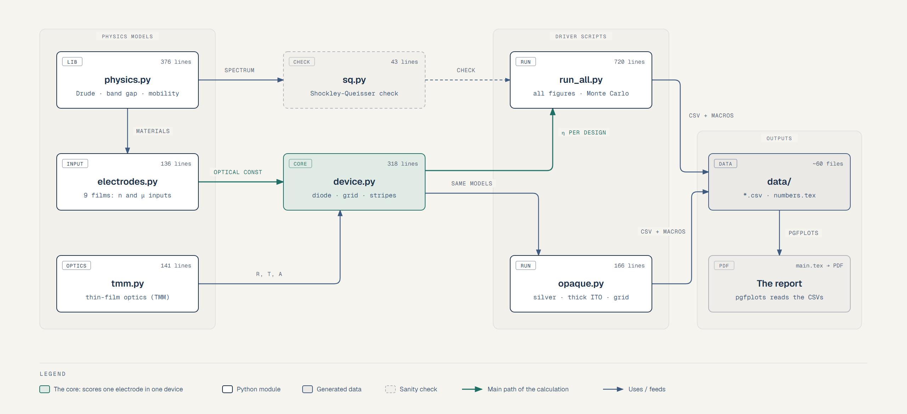
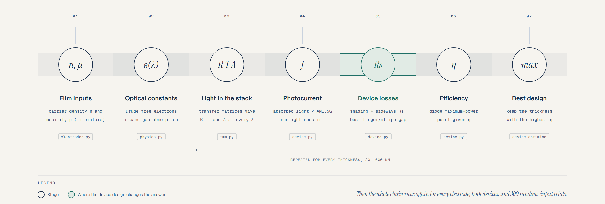

# Transparent electrodes for solar cells: a simulation study

This is the code behind my final-year physics project at The University of the West Indies, St. Augustine:
*A Comparative Study of Transparent Electrodes for Photovoltaic Technology* (PHYS 3153, Project 10, 2026),
supervised by Dr. Dinesh Pathak.

The front of a solar cell needs a layer that lets sunlight in **and** carries the current sideways to the
metal contacts. Those two jobs work against each other, because the free electrons that make a film conduct
also absorb and reflect light. This code takes the two numbers that describe a film, its free-electron
density *n* and mobility *μ*, and works out how efficient a real solar cell would be with that film on top.

I used it to compare nine transparent electrodes (ITO, IO:H, AZO, FTO, ZnO/Ag/ZnO, graphene, silver
nanowires, PEDOT:PSS and carbon nanotubes) in two kinds of cell, a silicon heterojunction cell and a
perovskite thin-film module, and to compare them with non-transparent contacts.

## The main results

| Electrode | Silicon cell | Perovskite module |
|---|---|---|
| **IO:H** (hydrogen-doped indium oxide) | **25.19 %** | **22.05 %** |
| ITO (tin-doped indium oxide) | 24.25 % | 21.81 % |
| FTO (fluorine-doped tin oxide) | 24.56 % | 21.29 % |
| AZO (aluminium-doped zinc oxide) | 24.36 % | 21.30 % |
| A perfect, lossless electrode | 25.87 % | 23.64 % |

- **Mobility matters more than doping.** Adding electrons buys conductivity and absorption together; raising
  the mobility buys conductivity and *removes* absorption. IO:H, with few electrons that move easily, wins in
  both devices, and stays first in 97 % and 94 % of 300 trials with randomly varied inputs.
- **The device changes the ranking.** ITO is second on glass and in the module, but fourth in the silicon
  cell, where the metal grid makes conductivity cheap and leaves its optical losses exposed.
- **Opaque contacts can't replace it.** A 50 nm silver film conducts far better than any oxide but reflects
  96 % of the light. A bare metal grid works in the silicon cell only because the wafer itself conducts.

All efficiencies are model results for comparing electrodes, not predictions for a real cell
(see [Limits](#limits)).

## How the code fits together



Eight Python files, each with one job:

| File | What it does |
|---|---|
| [`physics.py`](code/physics.py) | The physics: free electrons in a doped oxide (Drude model), the band gap and how doping shifts it, mobility limits, silver and graphene, and the solar spectrum. |
| [`electrodes.py`](code/electrodes.py) | The materials: *n* and *μ* for each film, taken from the literature, and simple models of the silicon and perovskite absorbers. |
| [`tmm.py`](code/tmm.py) | Thin-film optics. The transfer-matrix method tells you how much light is reflected, transmitted and absorbed at every wavelength. |
| [`device.py`](code/device.py) | **The heart of it.** Turns light and sheet resistance into a cell efficiency, choosing the best finger spacing (silicon cell) or stripe width (module) for each electrode. |
| [`sq.py`](code/sq.py) | A sanity check: the Shockley–Queisser limit for the spectrum used. |
| [`run_all.py`](code/run_all.py) | Runs every calculation in the report, including the 300-trial Monte Carlo test. |
| [`opaque.py`](code/opaque.py) | The non-transparent contacts: silver films, very thick oxides and a bare metal grid. |
| [`make_fallback.py`](code/make_fallback.py) | Placeholder numbers so the report still compiles before the Monte Carlo has run. |

## How one electrode gets its score



Steps 3 to 6 are repeated for every film thickness from 20 to 1000 nm, and the best one is kept. Then the
whole chain runs again for every electrode, both devices, and 300 Monte Carlo trials.

## Running it

You need Python 3.12 or newer and NumPy 2 or newer. NumPy is the only third-party dependency.

```bash
git clone https://github.com/M3RCU3Y/transparent-electrode-simulation.git
cd transparent-electrode-simulation
python -m pip install -r requirements.txt
cd code
python run_all.py          # everything, about 10-15 minutes
python run_all.py --quick  # same, with a 6-trial Monte Carlo instead of 300
python opaque.py           # the non-transparent contacts, about a second
```

Results go into [`data/`](data/):

- one CSV file per figure (the report reads these directly with pgfplots), and
- `numbers.tex` / `numbers.json`, which hold every number quoted in the text.

The report imports the generated tables, figure data and numerical macros from these files.
The random seed is fixed (`20261105`), so you should get
the same results with the same Python and NumPy versions. Small numerical differences can occur across
versions or platforms. The quick run uses fewer trials and overwrites the Monte Carlo outputs in
`data/`; run the full command again to restore the 300-trial results.

## What's in the repository

```
transparent-electrode-simulation/
├── code/                  the simulation (start with device.py)
│   └── spectrum_data/     the ASTM G173-03 solar spectrum
├── data/                  everything the code writes, as used in the report
├── docs/                  the two diagrams above (.png, .svg, and .html with notes)
│   └── source/            scripts that draw the diagrams
├── requirements.txt
├── CITATION.cff
└── LICENSE
```

## Limits

This is a simulation, and it is worth being clear about what that means:

- The film properties are typical values from published papers, not films I made or measured.
- Contact resistance, sputter damage to the layers underneath, long-term stability and cost are not modelled.
- Graphene, nanowires, nanotubes and PEDOT:PSS use simpler models than the oxides.
- The silver model's resistivity is about 24 % too high, so the silver results are the least certain.

The obvious next step is experimental: measure the sheet resistance and transmission spectrum of a real
coated-glass sample and see how well the model predicts it.

## Acknowledgements

Thanks to my supervisor, Dr. Dinesh Pathak, and to Dr. Ricardo Clarke, the course coordinator.

The solar spectrum is the ASTM G173-03 reference, as distributed by the US National Laboratory of the
Rockies (formerly NREL). AI tools assisted with writing and tidying the code, as declared in the report.
The numerical outputs were checked against the original results after the readability changes. The diagrams were made with
[diagram-design](https://github.com/cathrynlavery/diagram-design).

## Licence

MIT. See [LICENSE](LICENSE). If you use this in your own work, please cite it (see [CITATION.cff](CITATION.cff)).
